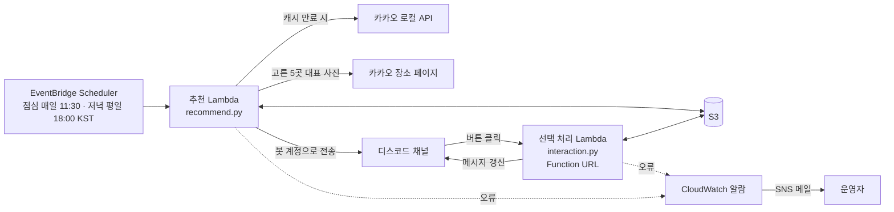
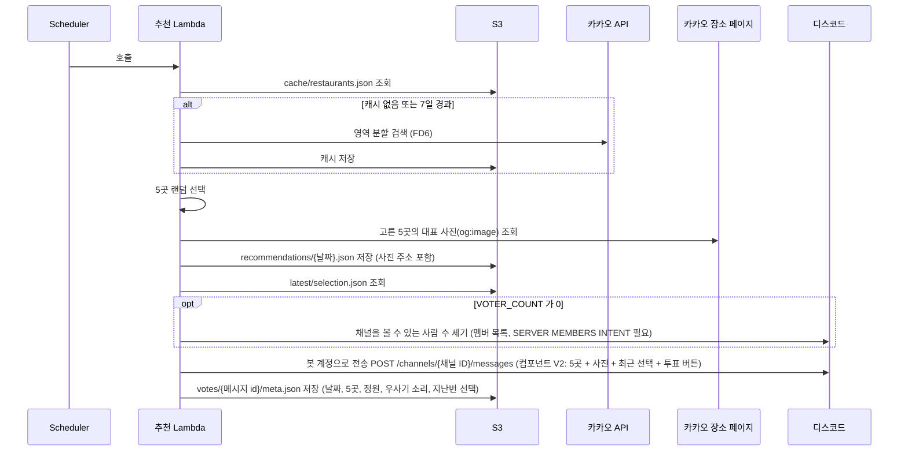
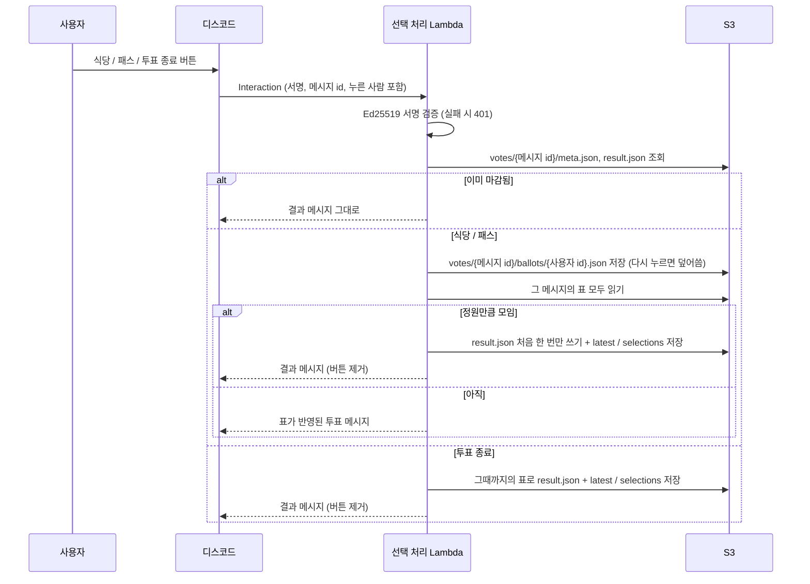
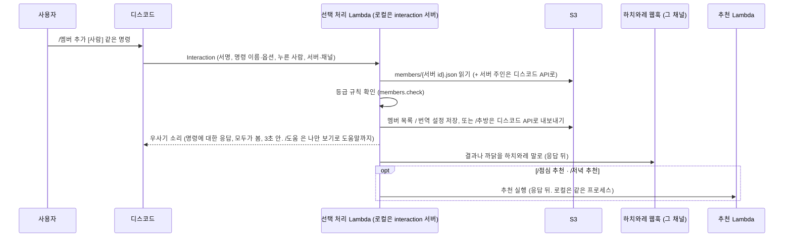

# 강남역 점심 추천 봇 — 설계 문서

> 상태: **초안** (코드 작성 완료, 로컬 테스트 145개 모두 통과) · 마지막 정리: 2026-10-25

## 1. 개요

매일 오전 11:30(KST)에 강남역 반경 800m 안의 식당 5곳을 랜덤으로 골라 디스코드 `오점뭐` 채널로 보낸다.
평일 18:00에는 야근 저녁용으로 식사 4곳 + 술집 1곳을 `오저뭐` 채널로 보낸다 (§7 저녁).
`우사기` 채널에 채팅을 보내면 우사기 봇이 채팅 내용에 맞춰 우사기 소리로 답하고, 하치와레(웹훅)가 그 뜻을 번역한다 (§7 우사기 채널, 하치와레).
사용자는 메시지의 버튼으로 오늘 갈 식당을 고르고, 고른 기록은 S3에 쌓인다.
다음 날 추천 메시지에는 가장 최근에 고른 식당이 함께 표시된다.

## 2. 요구사항

| # | 요구사항 | 반영 |
| --- | --- | --- |
| R1 | 매일 11:30에 AWS 스케줄러로 1회 실행 | EventBridge Scheduler (`Asia/Seoul`) |
| R2 | 강남역 반경 800m 식당 중 5곳 랜덤 추천 (2026-10-24에 1km에서 줄임) | 카카오 로컬 API 수집 + `random.sample` |
| R10 | 디저트(빵집·케이크·아이스크림)는 식당 추천에서 뺌 (2026-10-24 추가) | 카카오 `간식` 분류 제외 (§5) |
| R11 | 봇을 뺀 채널 참여 인원이 모두 투표하면 가장 많이 받은 식당으로 정함. 투표를 끝내는 버튼도 둠 (2026-10-24 추가) | 투표 정원(`VOTER_COUNT` 또는 자동 집계) + `투표 종료` 버튼 (§7 투표) |
| R12 | 누가 어디에 투표했는지 메시지에 보임 (2026-10-24 추가) | 식당마다 `N표 · 이름들` (§7) |
| R13 | 오저뭐 채널에 평일 18시 저녁 추천. 야근 저녁이라 점심과 차별화 (2026-10-24 추가) | 식사 4곳 + 술집 1곳, 오늘 점심 식당 제외, 남색 띠, 따로 저장 (§7 저녁) |
| R14 | 우사기 채널에 채팅을 보내면 우사기 봇이 답함. 진짜 대화하듯 채팅 내용에 맞춰, 너무 짧거나 길지 않게 (2026-10-24 추가) | 게이트웨이에 붙어 있는 봇 `usagi_bot.py` + 채팅 종류별 소리 `chat.py` (§7 우사기 채널) |
| R15 | 로컬에서 띄우는 서버는 모두 도커로 (2026-10-24 추가) | `compose.yaml`: interaction, tunnel, usagi (§9 로컬 서버) |
| R16 | 하치와레 봇이 우사기 말을 번역해 사람들에게 전함. 웹훅으로, 우선 우사기 채널에만, 우사기가 답할 때마다 (2026-10-25 추가). 기본은 꺼짐으로 바꿈 (같은 날) | 우사기 채널 웹훅 + 정해 둔 문장 조합 `hachiware.py`, `/하치와레 번역 켜기·끄기` (§7 하치와레) |
| R17 | 우사기 명령으로 멤버를 등록하고 등급(행인 → 직장인 → 대장 갑옷씨)에 따라 명령을 쓰게 함. 도움, 번역 켜기·끄기, 추방, 멤버 추가·삭제·승급 (2026-10-25 추가). 나만 보기는 `/도움`만 (같은 날 정함) | 슬래시 명령 `commands.py` + 등급 규칙 `members.py`, 답은 우사기 소리 + 그 채널의 하치와레 웹훅 (§7 우사기 명령) |
| R18 | 누구나 `/점심 추천`, `/저녁 추천`으로 오점뭐·오저뭐에 추천을 보냄 (2026-10-25 추가) | 우사기 명령, 추천은 응답 뒤에 따로 (§7 우사기 명령) |
| R19 | 하치와레 번역을 끄면 우사기가 무슨 말을 하든(대화, 추천, 투표 결과, 명령 결과) 번역하지 않음. 켜면 메뉴 추천과 투표 결과도 번역 (2026-10-25 추가) | 번역 스위치 하나로 하치와레 전체를 켜고 끔 (`/도움` 제외), `recommend_script`·`result_script` (§7 하치와레) |
| R20 | `/우사기`로 우사기와 1:1 대화 (2026-10-25 추가) | 우사기 채널 아래 사람마다 비공개 스레드, 스레드 안에서도 우사기 채널처럼 답함 (§7 우사기 명령) |
| R21 | 하치와레 번역을 개인 단위로 켜고 끔. 모두가 보는 채널(메뉴 추천·투표 결과 포함)은 서버 전체 설정으로, 직장인 갑옷씨 이상이 바꿈 (2026-10-25 추가) | 개인 `/하치와레 번역 켜기·끄기`는 내 1:1 스레드, 서버 전체 `/하치와레 전체 켜기·끄기`는 모두가 보는 채널 (§7 하치와레) |
| R3 | 식당 이름, 네이버 지도 검색 링크, 메뉴 5개 정도 전달 | 메뉴 대신 가장 구체적인 분류(`국밥`)와 카카오 대표 사진 (§7). 메뉴 목록은 미정 (§10 Q1) |
| R4 | 메시지 안에서 식당 선택 가능 | 버튼 투표 (§7 투표) |
| R5 | "선택 안함" 선택지 제공 | `패스` 버튼, 저장 없음 |
| R6 | 고른 식당을 날짜와 함께 S3에 저장 | §6 |
| R7 | 추천 시 가장 최근 선택을 함께 표시, 없으면 "없다"고 표시 | `latest/selection.json` 조회 |
| R8 | 한식·중식·일식 등 카테고리별로 분류해 저장 | `selections/{카테고리}/` |
| R9 | `latest` 고정 경로에 덮어쓰기 + 카테고리 저장 (총 2번 저장) | §6 |

## 3. 아키텍처



| 구성 요소 | 역할 |
| --- | --- |
| EventBridge Scheduler | 매일 11:30 KST에 추천 Lambda 호출 (`cron(30 11 * * ? *)`) |
| 추천 Lambda (`recommend.py`) | 식당 목록 확보(캐시/수집) → 5곳 랜덤 → 대표 사진 조회 → 추천 기록 저장 → 봇 계정으로 메시지 전송 |
| 선택 처리 Lambda (`interaction.py`) | 투표 버튼 수신(서명 검증) → 표 저장·집계 → 마감되면 결과 저장 → 메시지 갱신 |
| S3 버킷 | 식당 캐시, 추천 기록, 선택 기록 저장 (퍼블릭 접근 차단) |
| 카카오 로컬 API | 음식점(`FD6`) 위치·분류 정보 출처 |
| 카카오 장소 페이지 | 고른 5곳의 대표 사진(`og:image`) 출처 (§7) |
| 디스코드 앱 (봇 계정 `우사기 봇`) | 봇 토큰으로 채널에 메시지 전송 + 클릭 이벤트 전달 (봇 상시 실행 불필요) |
| CloudWatch 알람 + SNS | 두 Lambda에 오류가 나면 배포 때 지정한 이메일로 알림 (§9) |
| 우사기 채널 봇 (`scripts/usagi_bot.py`) | 디스코드 게이트웨이에 계속 붙어 우사기 채널 채팅에 우사기 소리로 답함. Lambda가 아니라 항상 켜 두는 서버 (§7 우사기 채널) |
| 하치와레 웹훅 | 하치와레가 말할 채널마다 만든 웹훅. 우사기 채널 것은 번역, 모든 채널 것은 그 채널의 우사기 명령 안내에 씀 (§7 하치와레, 우사기 명령) |
| 우사기 명령 | 디스코드 슬래시 명령. 클릭과 같은 Interactions Endpoint URL로 들어와 선택 처리 Lambda(로컬은 `interaction` 서버)가 처리 (§7 우사기 명령) |
| 로컬 서버 (도커) | 버튼 처리 서버, cloudflared 임시 터널, 우사기 채널 봇을 `docker compose`로 띄움. 아직 AWS에 배포하지 않아 버튼 처리도 로컬 서버가 맡음 (§9 로컬 서버) |

## 4. 처리 흐름

### 4.1 추천 (점심 매일 11:30, 저녁 평일 18:00)



### 4.2 투표 (버튼 클릭)



디스코드는 3초 안에 응답을 요구한다. 한 번 누를 때 S3 읽기·쓰기는 표 수(많아야 7개 안팎)에 비례해 10번 안팎이라 시간 안에 처리할 수 있다고 판단.

### 4.3 우사기 명령 (슬래시 명령)



## 5. 식당 수집

- **출처**: 카카오 로컬 API 카테고리 검색 `GET /v2/local/search/category.json`, `category_group_code=FD6`
- **제약**: 한 번 검색에 결과는 최대 45개 (15개 × 3페이지)
- **방법**: 강남역을 중심으로 반경(`RADIUS_M`, 기본 800m) 원을 감싸는 사각형(`rect`)에서 시작해, 결과가 45개를 넘으면 4등분해 재귀 검색 (최대 깊이 8). 원과 겹치지 않는 사각형은 건너뜀
- **후처리**: 장소 `id`로 중복 제거 → 중심과의 실제 거리(haversine, 반올림 전)가 반경 이하인 곳만 남김 → 제외 카테고리 필터링
- **캐시**: `cache/restaurants.json`에 저장한다. 모을 때의 중심 좌표, 반경, 뺀 분류(`exclude`)도 함께 기록한다.
  - 점심과 저녁이 빼는 분류가 달라서 (점심은 술집을 빼고 저녁은 술집이 필요), 캐시는 **아무 분류도 빼지 않고 전부** 모은다 (`exclude: []`)
  - 추천할 때마다 캐시를 그 끼니의 설정으로 거른다. 제외 분류에 든 곳과, 좌표로 잰 실제 거리가 반경을 넘는 곳을 뺀다. 그래서 반경을 줄이거나 제외 분류를 바꾸면 다음 추천부터 바로 반영된다
  - 다음 경우에는 캐시를 버리고 다시 모은다: 7일이 지남(`CACHE_DAYS`), 중심 좌표가 바뀜, 반경이 캐시보다 넓어짐, 분류를 빼고 모은 예전 캐시(`exclude`가 비어 있지 않거나 없음)
  - 수동 호출 시 `{"refresh": true}`로 강제 재수집한다 (이 호출도 추천 메시지를 한 번 더 보낸다)
  - 2026-10-24 기준: 800m 안을 전부 모으면 1,479곳이고, 그중 술집 226곳, 간식 80곳이다
- **재시도**: HTTP 429/5xx는 최대 3번 재시도 (첫 시도 포함 총 4번). 타임아웃 같은 네트워크 오류는 재시도 없이 바로 실패한다
- **카테고리**: 카카오 분류의 두 번째 단계 사용 (`음식점 > 한식 > 국밥` → `한식`)
- **제외**: 점심 추천이라 `술집`과 `간식`(빵집·케이크·아이스크림 같은 디저트, 2026-10-24 추가) 분류 제외 (`EXCLUDE_CATEGORIES`)
- **대표 사진**: 수집할 때가 아니라 추천할 때, 고른 5곳만 가져온다 (§7)

## 6. S3 데이터 설계

| 키 | 쓰기 시점 | 방식 | 용도 |
| --- | --- | --- | --- |
| `latest/selection.json` | 투표로 식당이 정해졌을 때 | 덮어쓰기 | 최근 선택 조회 (추천 메시지용) |
| `selections/{카테고리}/{YYYY-MM-DD}.json` | 투표로 식당이 정해졌을 때 | 날짜별 생성 | 카테고리별 선택 기록 |
| `recommendations/{YYYY-MM-DD}.json` | 추천 시 | 날짜별 생성 (같은 날 다시 추천하면 덮어씀) | 그날 추천 기록 |
| `cache/restaurants.json` | 수집 시 | 덮어쓰기 | 식당 목록 캐시 (분류를 빼지 않고 전부. 점심·저녁 함께 씀) |
| `dinner/latest/…`, `dinner/selections/…`, `dinner/recommendations/…` | 저녁 | 점심과 같음 | 저녁(오저뭐)의 기록. 점심과 따로 둠 |
| `votes/{메시지 id}/meta.json` | 추천 메시지를 보낸 뒤 | 메시지마다 생성 | 투표 정보: 끼니(`meal`), 날짜, 5곳(사진 포함), 정원, 우사기 소리, 지난번 선택, 오늘 점심(저녁만). 메시지를 다시 그릴 때 씀 |
| `votes/{메시지 id}/ballots/{사용자 id}.json` | 식당·패스를 누를 때 | 사람마다 하나, 다시 누르면 덮어씀 | 한 사람의 표 (이름, 고른 것, 시각) |
| `votes/{메시지 id}/result.json` | 마감할 때 | 처음 한 번만 (조건부 쓰기) | 마감 결과 (정해진 식당, 표 수, 투표한 사람, 소리) |

예시 경로:
```
latest/selection.json
selections/한식/2026-10-23.json
selections/일식/2026-10-24.json
recommendations/2026-10-24.json
cache/restaurants.json
votes/1563485951970381909/meta.json
votes/1563485951970381909/ballots/{사용자 id}.json
votes/1563485951970381909/result.json
```

### 선택 기록 (`latest`와 `selections`에 같은 내용 저장)

```json
{
  "id": "12345678",
  "name": "식당명",
  "category": "한식",
  "category_detail": "한식 > 국밥",
  "address": "서울 강남구 ...",
  "phone": "02-000-0000",
  "lat": 37.4979,
  "lng": 127.0276,
  "distance_m": 230,
  "kakao_url": "http://place.map.kakao.com/12345678",
  "photo_url": "https://img1.kakaocdn.net/cthumb/local/C800x400.q50/?fname=...",
  "naver_url": "https://map.naver.com/p/search/강남역%20식당명",
  "date": "2026-10-24",
  "selected_at": "2026-10-24T11:42:10+09:00",
  "selected_by": "투표",
  "voters": ["민지", "현우"],
  "votes": { "식당명": 2, "다른 식당": 1, "패스": 1 }
}
```

### 추천 기록

```json
{ "date": "2026-10-24", "created_at": "2026-10-24T11:30:02+09:00", "picks": [ "...식당 5곳 (photo_url 포함)..." ] }
```

`photo_url`은 사진을 못 가져오면 `null`이다.

### 투표 기록

```json
// votes/{메시지 id}/ballots/{사용자 id}.json
{ "user_id": "...", "name": "민지", "choice": "12345678", "voted_at": "2026-10-24T11:35:02+09:00" }
// votes/{메시지 id}/result.json  (choice 의 "skip" 은 패스)
{ "winner": "12345678", "counts": { "12345678": 2, "skip": 1 }, "voters": { "12345678": ["민지", "현우"], "skip": ["서연"] },
  "voted": 3, "expected": 7, "sound": "야하~", "closed_by": "민지", "closed_at": "2026-10-24T11:52:10+09:00" }
```

### 멤버와 설정

```json
// members/{서버 id}.json  (rank: 1 행인, 2 직장인, 3 대장. 서버 주인은 목록에 없어도 대장)
{ "members": { "123...": { "rank": 2, "name": "민지", "by": "서버주인", "at": "2026-10-25T13:05:00+09:00" } },
  "updated_at": "2026-10-25T13:05:00+09:00" }
// settings/hachiware.json  (없으면 꺼짐)
{ "translate": true, "by": "민지", "at": "2026-10-25T13:06:00+09:00" }
```

### 저장 규칙
- 투표로 식당이 정해지면 `latest`를 덮어쓰고 그날 카테고리 파일을 쓴다
- 같은 날 메시지가 둘이고 둘 다 서로 다른 카테고리로 정해지면 카테고리 파일이 둘 다 남는다 (§10 Q3)
- 선택 없이 끝나면 아무것도 쓰지 않으므로 `latest`는 이전 선택을 유지한다

## 7. 디스코드 메시지

컴포넌트 V2(`flags: 32768`)로 만든 한 장짜리 목록이다. 이모티콘은 쓰지 않는다.

```
우라! 야하~
-# 10월 24일 토요일 · 지난번 없음 · 투표 3/7
──────────────────────────────
주신당 강남점  (네이버 지도 검색 링크)              [대표 사진]
한식 · 212m
-# 2표 · 민지, 현우
──────────────────────────────
… 5곳
-# 패스 1표 · 서연
──────────────────────────────
[주신당 강남점] [밥심] … (식당 5개)
[패스] [투표 종료]
```

### 구성

| 컴포넌트 | 내용 |
| --- | --- |
| Container (17) | 전체를 감싸는 테두리. 왼쪽 띠 색 `0xEF9F27` |
| Text Display (10) | 첫 줄은 우사기 소리. 둘째 줄(`-# ` 작은 회색 글씨)은 날짜, 지난번 선택(`지난번 {식당} ({M/D})`, 없으면 `지난번 없음`), 투표 진행(`투표 3/7`, 정원을 모르면 `투표 3명`) |
| Section (9) + Thumbnail (11) | 식당 한 곳: 굵은 이름(네이버 지도 링크), `메뉴 · 거리`, 표가 있으면 `N표 · 이름들`, 오른쪽에 대표 사진. Section은 사진이 꼭 있어야 해서, 사진이 없으면 Text Display만 쓴다 |
| Text Display (10) | 패스에 표가 있으면 목록 아래에 `패스 N표 · 이름들` |
| Separator (14) | 식당 사이와 버튼 위의 가는 선 |
| Action Row (1) + Button (2) | 식당 버튼 5개 한 줄 + `패스`, `투표 종료`(빨간 버튼) 한 줄 (한 줄 최대 5개) |

- 한 메시지의 컴포넌트는 많아야 32개로, 디스코드 한도(40개) 안이다
- 메뉴는 카카오 분류의 가장 구체적인 단계다 (`한식 > 육류,고기 > 곱창,막창` → `곱창,막창`)
- 컴포넌트 V2 메시지에는 `content`와 `embeds`를 쓸 수 없다

### 대표 사진

- 추천할 때 고른 5곳만, 카카오 장소 페이지(`place.map.kakao.com/{id}`)의 `og:image`(링크 미리보기용 그림)를 읽어 썸네일로 쓴다. 하루 5번 요청한다
- 사진이 없는 장소는 카카오가 지도 이미지를 준다. 페이지를 읽지 못하면 사진 없이 보낸다 (추천은 막지 않는다)
- 사진 주소는 추천 기록의 `picks[].photo_url`에 남겨, 버튼을 누른 뒤 메시지에도 같은 사진을 쓴다
- 네이버 지도 검색 링크의 미리보기 그림은 네이버 지도 로고뿐이라 쓰지 않는다. 네이버 장소 사진은 공식 API로 받을 방법이 없다
- 2026-10-24 확인: 무작위 12곳 중 11곳은 실제 사진, 1곳은 지도 이미지였다. 실제로 보낸 메시지의 썸네일 5장은 모두 디스코드가 불러왔다

### 우사기 소리

먼작귀의 우사기는 말을 하지 않으므로 소리만 낸다 (`src/lunchbot/messages.py`).
상황마다 소리의 '모양'을 비중에 따라 하나 고르고, 그 안을 소리 조각으로 채운다. X·Y는 서로 다른 조각, `푸르르르`는 길이가 바뀌는 떨림 소리(`르` 3~5개)다.

| 상황 | 조각 | 모양 (괄호는 비중) |
| --- | --- | --- |
| 추천 | 우라, 야하, 야앗, 이얏, 와앗 | `X!`(3) `X X`(2) `X~`(2) `X! Y~`(2) `X… Y!`(1) `푸르르르… X!`(1) `X X!!`(1) |
| 투표로 식당이 정해진 뒤 | 야하, 우라, 와앗 | `X!`(3) `X~`(2) `X X!`(2) `X! Y~`(1) `X!!`(1) |
| 패스가 가장 많거나 아무도 투표하지 않고 끝난 뒤 | 후웅, 흐응 | `X…`(3) `푸르르르…`(2) `X… 푸르르르`(1) `X`(1) |
| 버튼 오류 (누른 사람에게만 보임) | 하아, 후웅, 하 | `X?`(3) `X…?`(1) |

- 2026-10-25부터 추천 메시지 머리말과 투표 결과의 소리, 우사기 명령의 응답 소리는 위 모양 대신 하치와레 번역과 짝지어 만든다 (§7 하치와레 번역 방법). 위 모양은 버튼 오류처럼 번역이 없는 곳과 기본값에만 남았다
- 2026-10-24에 바꿨다. 예전에는 조각마다 `!`나 `!!`를 붙여 1~3개를 이어 붙여서, 추천 줄의 약 71%에 `!!`가 들어가고 줄마다 느낌표가 평균 3개였다
- 지금은 추천 소리 1000번 중 `!!`가 87번(약 9%)이고, 34%는 느낌표 없이 끝나며, 줄마다 느낌표는 평균 0.74개다
- 테스트는 '정해 둔 조각과 떨림 소리만 쓴다', '`!!`는 20% 이하', '모양이 4가지 이상 섞인다', '같은 소리를 두 번 내는 모양이 있다'를 확인한다

### 투표

- 버튼 `custom_id`: `pick:{날짜}:{카카오 장소 id}`, `skip:{날짜}`, `end:{날짜}`. 어느 투표인지는 Interaction에 담긴 메시지 id로 찾는다 (`votes/{메시지 id}/meta.json`)
- 한 사람(디스코드 계정 id) 한 표이고, 다시 누르면 바뀐다. 패스도 한 표다. 이름은 서버 별명 → 디스코드 표시 이름 → 아이디 순서
- 누를 때마다 메시지를 다시 그린다 (응답 type 7, `flags: 32768`). 맨 위 소리는 보낼 때 정한 것을 마감까지 쓴다
- 정원: `VOTER_COUNT`(배포 파라미터 `VoterCount`)가 0보다 크면 그 값, 0이면 추천을 보낼 때 채널을 볼 수 있는 사람 수(봇 제외)를 센다.
  세려면 멤버 목록이 필요해 개발자 포털 Bot 탭의 SERVER MEMBERS INTENT를 켜야 한다. 셀 수 없으면 정원 없이 `투표 종료`로만 끝난다
- 마감: 정원만큼 표가 모이거나 누구든 `투표 종료`를 누르면 끝난다. 가장 많이 받은 식당으로 정하고, 동점이면 동점인 식당 중 무작위, 패스와 식당이 동점이면 식당. 패스가 가장 많거나 표가 없으면 선택 없음
- 마감 후 메시지: 소리와 `-# 투표 끝 · {식당별 표 수} · {정원}명 중 {N}명 투표` 한 줄, 고른 식당 카드(투표한 사람 포함). 늦게 눌린 버튼에도 같은 결과를 보여 준다
- 동시에 눌러도 표가 사라지지 않게 표는 사람마다 따로 저장하고, 마감 결과는 S3 조건부 쓰기(`If-None-Match: *`)로 처음 한 번만 쓴다. 두 사람이 거의 동시에 마감시켜도 결과는 하나다
- 같은 날 추천을 다시 보내도 메시지마다 따로 센다. 투표 기능 전에 보낸 메시지(`meta.json`이 없음)의 버튼은 오류 소리("하아?")만 보인다
- 메시지에 없는 식당 id로 누르면 누른 사람에게만 오류 소리를 보여준다
- 링크 형식: `https://map.naver.com/p/search/{URL 인코딩("강남역 " + 식당명)}`

### 저녁 (오저뭐)

2026-10-24에 추가했다. 야근하면서 먹는 저녁을 정하는 자리이고, 가끔 술자리가 된다. 점심과 같은 메시지·투표를 쓰고 다음만 다르다 (`src/lunchbot/meals.py`).

| | 점심 (오점뭐) | 저녁 (오저뭐) |
| --- | --- | --- |
| 보내는 때 | 매일 11:30 (`ScheduleCron`) | 평일 18:00 (`DinnerScheduleCron`, 이벤트 `{"meal": "dinner"}`) |
| 채널 | `DISCORD_CHANNEL_ID` | `DINNER_CHANNEL_ID` |
| 5곳 구성 | 식사 5곳 | 식사 4곳 + 술집 1곳(마지막 자리). 반경 안에 술집이 없으면 식사 5곳 |
| 빼는 분류 | `EXCLUDE_CATEGORIES` (술집, 간식) | `DINNER_EXCLUDE_CATEGORIES` (간식, 구내식당). 술집은 식사 자리에서 빼고 술집 자리에만 |
| 더 빼는 것 | 없음 | 오늘 점심으로 정해진 식당 (`latest/selection.json`의 날짜가 오늘이면) |
| 정보 줄 | `{날짜} · 지난번 {식당} ({M/D})` | `{날짜} 저녁 · 오늘 점심 {식당}` (점심이 아직이면 `오늘 점심 없음`) |
| 띠 색 | `0xEF9F27` (노란 주황) | `0x3A5BA0` (남색) |
| 정원 | `VOTER_COUNT` 또는 오점뭐 인원 | `DINNER_VOTER_COUNT` 또는 오저뭐 인원 |
| 결과 저장 | `latest/`, `selections/`, `recommendations/` | `dinner/latest/`, `dinner/selections/`, `dinner/recommendations/` |

- 투표 기록(`votes/{메시지 id}/…`)은 함께 쓰고, `meta.json`의 `meal`과 `today_lunch`로 저녁 메시지를 다시 그리고 저녁 위치에 저장한다
- 우사기 소리와 대표 사진, 투표 규칙은 점심과 같다
- 2026-10-24 오저뭐 첫 메시지: 쌀국수·양꼬치·국밥·중국요리 + 이자카야(일본식주점), 오늘 점심(KFC 강남역점)은 빠짐

### 우사기 채널

2026-10-24에 추가했다. `우사기` 채널(`USAGI_CHANNEL_ID`)에 사람이 채팅을 보내면 우사기 봇이 우사기 소리로 답한다.
처음에는 채팅 내용을 읽지 않고 상황별 소리 중 하나를 무작위로 냈는데, 같은 날 진짜 대화하는 것처럼 보이도록 채팅 내용에 맞춰 답하게 바꿨다.
우사기는 말을 못 하므로 답은 소리만 쓰고(`우라`, `야하`, `야앗`, `이얏`, `와앗`, `후웅`, `흐응`, `하아`, `하`, `푸르르르…`), 이모티콘과 해석은 붙이지 않는다.

**채팅 읽기** (`src/lunchbot/chat.py`)

- 채팅을 낱말 목록(`KINDS`)으로 가른다: 인사, 작별, 칭찬, 웃음, 피곤·슬픔, 짜증, 밥·술, 놀람, 맞장구, 우사기 부르기. 앞에 있는 종류가 먼저다 (`우사기 귀여워`는 부르기가 아니라 칭찬). `네`, `응`, `헐`처럼 짧은 낱말은 낱말 전체가 같아야 맞는다
- 종류마다 목소리(`VOICES`)가 있다: 첫 소리 후보, 둘째 소리부터 섞을 후보, 끝맺음(`!`, `~`, `…`, `?` …) 비중, 같은 소리를 잇달아 낼 비율. 예: 밥 이야기는 신난 소리에 `!`, 피곤함은 `후웅`·`흐응`·떨림 소리에 `…`
- 질문(`?`로 끝나거나 `뭐`, `왜`, `어디` …)이면 10번에 9번쯤 먼저 갸웃하는 소리(`하?`, `후웅?`, `하아…?`)를 내고 그 뒤에 종류에 맞는 소리를 낸다
- 두 종류가 섞이면 첫 소리는 첫 종류, 둘째 소리부터는 둘째 종류를 섞는다 (`야근인데 배고파 ㅠ` → `후웅… 우라!`)
- 채팅에 우사기 소리가 있으면 같은 소리로 받아친다 (`우라!` → `우라! 야하~`)
- 멘션, 커스텀 이모지, 링크는 지우고 읽는다. 아무 종류도 아니면 신난 소리 위주로 섞는다

**답 길이와 모양**

- 소리 개수는 채팅 길이를 따라간다: 2자 이하 대개 1개, 6자 이하 1~3개(대개 1~2개), 15자 이하 1~3개, 30자 이하 2~4개(대개 2~3개), 그보다 길면 2~4개. 최대 4개, 40자를 넘지 않는다. `ㅋ`를 6개 넘게 치면 한 개 더 웃는다
- 채팅에 `~`, `!`, `…`가 있으면 같은 끝맺음이 조금 더 잘 나온다
- 바로 전 답과 똑같은 답은 내지 않는다 (채널마다 기억)

**보내는 방식** (`chat.plan`, `scripts/usagi_bot.py`)

- 연달아 보낸 채팅은 1.5초 동안 새 채팅이 없을 때까지 모았다가 합쳐서 한 번에 답한다. 여러 사람이 섞여 있어도 마지막 채팅에 답한다
- 보내기 전에 `우사기 봇 입력 중…`을 보여 준다. 시간은 읽는 시간(채팅 길이) + 치는 시간(답 길이) + 들쭉날쭉으로 0.3~3초
- 답장 표시는 10번에 6번 단다 (안 달면 채널에 그냥 보냄). 답할 때 멘션 알림은 보내지 않는다
- 10번에 2번쯤 1초 안팎 뒤에 짧은 한마디(소리 하나)를 따로 더 보낸다 (`하?` 다음에 `우라!`)
- 봇(자기 자신 포함)의 채팅, 입장 알림 같은 시스템 메시지, 다른 채널의 채팅에는 답하지 않는다

**채팅 내용 읽기 권한**

- 채팅 내용은 특권 인텐트인 Message Content가 있어야 읽힌다. 개발자 포털 Bot 탭의 MESSAGE CONTENT INTENT(앱 플래그 `1<<19`, 인증된 봇은 `1<<18`)를 켜야 한다
- 봇은 시작할 때 `GET /applications/@me`의 플래그로 켜져 있는지 확인하고, 켜져 있을 때만 게이트웨이에 Message Content 인텐트를 요청한다. 꺼진 채로 요청하면 연결이 거절되기 때문이다. 확인한 뒤 꺼져서 거절되면 인텐트 없이 다시 연결한다
- 꺼져 있으면 채팅 내용이 빈 글자로 오므로 상황별 소리를 비중에 따라 무작위로 낸다 (신남 4, 기쁨 3, 시무룩 2, 부르기 1). 우사기 봇을 @멘션한 채팅은 권한이 없어도 내용이 오므로 내용에 맞춰 답한다
- 포털에서 켜거나 끈 뒤에는 봇을 다시 띄워야 반영된다 (`docker compose restart usagi`)

**서버**

- 버튼 클릭은 디스코드가 우리 주소(Interactions Endpoint URL)로 보내 주지만 일반 채팅은 그렇게 받을 수 없다. 그래서 봇이 디스코드 게이트웨이(웹소켓)에 계속 붙어 있어야 하고, Lambda가 아니라 항상 켜 두는 서버(`scripts/usagi_bot.py`, 도커 `usagi`)로 띄운다. 게이트웨이 연결은 `discord.py` 2.4.0 라이브러리를 쓴다
- 게이트웨이 인텐트는 `GUILDS`, `GUILD_MESSAGES`와 (권한이 있으면) `MESSAGE_CONTENT`만 쓴다

### 하치와레 (번역)

2026-10-25에 추가했다. 우사기는 말을 못 하지만 하치와레는 말을 할 수 있고 우사기 말을 알아듣는다는 설정으로, 우사기가 답한 뒤 하치와레가 그 뜻을 사람들에게 전한다.
우사기 메시지 자체에는 여전히 해석을 넣지 않는다.

- **보내는 곳**: 사용자가 채널마다 만든 웹훅(`HACHIWARE_WEBHOOK_URLS`, 쉼표로 구분, 이름 `하치와레 봇`). 일반 웹훅이라 버튼은 못 보내지만 글만 보내므로 충분하다. 봇은 주소마다 `GET 웹훅 주소`로 어느 채널 것인지 읽어 `{채널: 주소}`로 묶고 못 읽는 주소는 뺀다. 대화 번역은 우사기 채널 웹훅으로, 메뉴 추천 번역은 오점뭐·오저뭐 웹훅으로 하고, 모든 채널 웹훅은 그 채널의 우사기 명령 안내에 쓴다 (§7 우사기 명령). 예전 이름 `HACHIWARE_WEBHOOK_URL`도 함께 읽는다
- **메뉴 추천 번역** (2026-10-25 추가): 번역이 켜져 있으면 추천 메시지와 투표 결과의 우사기 소리도 그 채널(오점뭐·오저뭐)의 하치와레 웹훅이 번역한다. 처음에 스위치와 상관없이 늘 번역하게 잘못 만들었다가, 사용자 뜻("번역을 끄면 우사기가 무슨 말을 하든 번역하지 않음")대로 스위치를 따르게 고쳤다
  - 추천: `recommend.handler`가 `hachiware.recommend_script`로 머리말 소리와 번역을 함께 만들고, 메시지를 보낸 뒤 번역을 보낸다. 메시지가 실제로 나갔을 때만 하므로 `--preview`는 번역하지 않는다
  - 결과: 투표가 이번에 마감되면(정원이 차거나 `투표 종료`) `hachiware.result_script`로 결과 메시지의 소리와 번역을 함께 만들고, 번역은 응답 뒤에 보낸다. 투표 중이거나 이미 끝난 투표의 버튼에는 번역하지 않는다
  - 웹훅이 없거나 실패해도 추천·투표는 그대로다. 웹훅 목록은 `hachiware.hooks()`가 프로세스마다 한 번 읽어 둔다
- **켜고 끄기** (2026-10-25 개인 설정과 서버 전체로 나눔, 사용자 결정): 우사기 말이 나오는 곳에 따라 설정이 정해지고, 꺼져 있으면 그곳의 우사기 말은 무엇이든 번역하지 않는다 (`/도움`의 사용법만 예외). `hachiware.is_on(user_id)`가 정한다
  - 서버 전체: `/하치와레 전체 켜기·끄기`(직장인 갑옷씨 이상, 사용자 결정) → `settings/hachiware.json`. 모두가 보는 채널에 적용된다: 우사기 채널 대화, 메뉴 추천과 투표 결과, 명령의 결과 안내. 기본은 꺼짐
  - 개인: `/하치와레 번역 켜기·끄기`(누구나) → `settings/hachiware_people.json`. 그 사람의 `/우사기` 1:1 스레드 안(스레드 인사, 스레드 대화, 스레드에서 쓴 명령의 안내)에만 적용된다. 정하지 않은 사람은 서버 전체 설정을 따르고, 한 번 정하면 서버 전체가 바뀌어도 그대로다
  - 처음에는 개인 설정을 "그 사람 때문에 나오는 모든 번역"(우사기 채널에서 내 채팅에 대한 답 포함)에 적용했다가, 개인 번역만 켰는데 모두가 보는 우사기 채널에서 번역되는 게 꼬여 보인다는 사용자 지적으로 장소 기준으로 바꿨다 (명령은 `commands._place`, 대화는 `usagi_bot`이 채팅한 곳이 스레드인지로 고른다)
  - 우사기 채널 봇은 답할 때마다 설정을 읽는다 (그래서 `usagi` 컨테이너도 `.local-s3/`를 붙임). 못 읽으면 번역하지 않는다
- **언제**: 번역이 켜져 있으면 우사기가 답할 때마다(덧붙인 한마디까지 다 보낸 뒤) 1~2.2초 기다렸다가 올린다. 웹훅은 '입력 중…'을 보일 수 없고 답장 표시도 못 달아서 우사기 답 바로 아래에 이어서 올라간다
- **번역 방법** (`src/lunchbot/hachiware.py`): 정해 둔 말 토막 조합. 언어 모델은 쓰지 않는다 (API 키·비용 없이, 우사기 쪽과 같은 방식)
  - **소리 한 토막에 번역 한 토막** (2026-10-25 사용자 요청으로 바꿈): 우사기 소리가 둘이면 번역도 두 토막이고, 번역 토막의 끝맺음(`!`, `~`, `…`, `?`)과 소리의 끝맺음이 같다. 예전에는 소리와 번역을 따로 골라서 `우라!` 한마디에 "오늘 점심 메뉴 추천을 해준다고 해! 잠시만 기다려줘." 같은 긴 문장이 붙어 어색했다
  - 메뉴 추천·투표 결과·명령은 소리와 번역을 함께 만든다 (`Script`). 토막마다 (기분, 말)을 고르면 `speak`가 기분(`messages.MOODS`: 신남, 기쁨, 시무룩, 갸웃, 떨림)에 맞는 소리를 말의 끝맺음으로 낸다. 추천은 여는 말 + 그날 상황(`FACTS`: 지난번 간 곳, 술집 자리, 오늘 점심 뺀 것, 10번에 7번) + 덧붙이는 말(10번에 4번) + 닫는 말로 2~4토막이고, 메시지 머리말의 우사기 소리도 여기서 나온다. 투표 결과는 `RESULT`(식당 이름이 든 토막)·`NO_RESULT`, 명령은 `NOTICES`(키는 `members.check`의 까닭과 명령 결과, 추방은 늘 `우라!` 한 토막)
  - 우사기 채널 대화는 우사기가 이미 낸 소리(`chat.plan`)를 토막마다 옮긴다 (`chunks`). 우사기가 채팅을 읽은 결과(`chat.read`)로 토막의 뜻을 고른다: 갸웃한 첫 소리는 갸웃한 말(`MEANINGS["ask"]`), 섞인 채팅이면 둘째 종류의 목소리로 낸 소리는 둘째 종류의 말, 나머지는 첫 종류의 말. 종류를 모르면(plain, unknown) 그 소리의 느낌(`SOUNDS`). 같은 소리를 잇달아 내면 같은 말을 되풀이하고, 끝맺음만 다른 같은 말은 한 줄에 두 번 쓰지 않는다
  - 하치와레는 짧은 틀(`FRAMES`: `"…"래!`, `"…"래~`, `우사기가 "…"래`, `"…"라고 하네!`)로 전한다. 예전의 긴 틀은 토막 수가 어긋나서 뺐다
  - 대화와 메뉴 추천·투표 결과 번역에서는 10번에 3~4번 번역 뒤 따옴표 밖에 하치와레 자기 생각을 한마디 보탠다(`COMMENTS`: 대화 종류마다, 추천은 `lunch`·`dinner`, 결과는 `won`(식당 이름을 넣을 수 있음)·`none`. 추천·결과는 `retell`). 명령의 결과 안내에는 붙이지 않는다. 짝짓기로 바꿀 때 함께 뺐다가, 좋은 기능이라는 사용자 요청으로 따옴표 밖에 다시 넣었다 (2026-10-25). 따옴표 안의 번역은 소리와 토막 수가 같고, 80자를 넘으면 자기 생각부터 뺀다. 4번에 1번 채팅한 사람 이름을 앞에 붙인다(멘션이 아니라 글자라 알림은 가지 않음). 채널마다 바로 전 번역은 되풀이하지 않는다
- **주고받기 막기**: 우사기 봇은 웹훅 메시지(`webhook_id`가 있는 메시지)에는 답하지 않는다. 막지 않으면 하치와레 번역에 우사기가 답하고 또 번역하는 일이 끝없이 이어진다
- **실패**: 웹훅 전송이 실패해도 우사기 답은 이미 나갔으므로 그대로 두고 로그에 경고만 남긴다. 시작할 때 웹훅들 중 우사기 채널 것이 없으면 번역하지 않는다
- `.env`의 웹훅 주소를 바꾼 뒤에는 `docker compose up -d interaction usagi`로 컨테이너를 새로 만들어야 새 값을 읽는다 (`restart`는 예전 환경 변수를 그대로 씀)

### 우사기 명령

2026-10-25에 추가했다. 디스코드 슬래시 명령으로 추천을 부르고, 서버 사람을 갑옷씨 멤버로 등록해 등급에 따라 명령을 쓰게 한다.

| 명령 | 필요한 등급 | 하는 일 |
| --- | --- | --- |
| `/도움` | 누구나 | 내 등급으로 쓸 수 있는 명령과 사용법 (하치와레) |
| `/우사기` | 누구나 | 나와 우사기 봇만 있는 비공개 스레드에서 1:1 대화 |
| `/점심 추천`, `/저녁 추천` | 누구나 | 오점뭐·오저뭐로 추천 보내기 |
| `/하치와레 번역 켜기`, `/하치와레 번역 끄기` | 누구나 | 나에 대한 우사기 말 번역 켜고 끄기 (개인 설정) |
| `/하치와레 전체 켜기`, `/하치와레 전체 끄기` | 직장인 갑옷씨 | 메뉴 추천·투표 결과 번역 켜고 끄기 (서버 전체, 기본 꺼짐) |
| `/멤버 추가 [사람]` | 행인 갑옷씨 | 멤버가 아닌 사람을 행인 갑옷씨로 |
| `/멤버 승급 [사람] [등급]` | 직장인 갑옷씨 | 자기보다 낮은 멤버를, 지금보다 높고 자기 등급 이하인 등급으로 |
| `/멤버 강등 [사람] [등급]` | 직장인 갑옷씨 | 자기보다 낮은 멤버를, 지금보다 낮은 등급으로 |
| `/멤버 삭제 [사람]` | 직장인 갑옷씨 | 자기보다 낮은 멤버를 멤버에서 뺌 |
| `/추방 [사람]` | 직장인 갑옷씨 | 자기보다 낮은 사람(멤버 아님 포함)을 서버에서 내보냄(kick). 우사기가 채널에 `우라!`(모두가 봄) |

**1:1 대화** (`/우사기`, 2026-10-25 추가)

- DM과 비공개 스레드 중 비공개 스레드로 정했다 (사용자 결정). DM에는 웹훅을 쓸 수 없어 하치와레가 하치와레 프로필로 나올 수 없기 때문이다. 대신 '스레드 관리' 권한이 있는 사람(서버 주인·관리자)은 볼 수 있다
- 우사기 채널 아래에 비공개 스레드(type 12, `invitable: false`, 일주일 조용하면 보관)를 `우사기 · 이름`으로 만들고 그 사람을 넣는다. 사람마다 하나라 `threads/{서버 id}.json`에 사용자 id → 스레드 id를 남기고, 다시 부르면 보관을 풀어 다시 쓴다. 스레드가 지워졌으면(404) 새로 만든다
- 답을 돌려준 뒤 우사기가 스레드에서 그 사람을 멘션해 인사한다(`greet_script`, 이 멘션만 알림을 보냄). 번역이 켜져 있으면 하치와레가 우사기 채널 웹훅에 `thread_id`를 붙여 그 스레드에 번역한다
- 스레드 안의 채팅은 우사기 채널 봇이 받는다. `chat.should_reply`가 채팅한 곳이 우사기 채널이거나 그 아래 스레드(`parent_id`)면 답한다. 모으기·되풀이 안 하기는 스레드마다 따로다
- 봇에 우사기 채널의 '비공개 스레드 만들기'(1<<36), '스레드에서 메시지 보내기'(1<<38) 권한이 필요하다 (`@everyone` 기본값으로 켜져 있음). 못 만들면 하치와레가 권한 문제라고 알린다

**등급 규칙** (`src/lunchbot/members.py`)

- 등급은 행인 갑옷씨(1) → 직장인 갑옷씨(2) → 대장 갑옷씨(3). 멤버가 아니면 0. 자기 등급과 그 아래 등급의 명령을 쓴다 (`NEEDS`)
- 서버 주인(`GET /guilds/{id}`의 `owner_id`)은 목록에 없어도 대장이고, 다른 대장보다도 높다. 아무도 주인을 내리거나 빼거나 내보낼 수 없다. 처음 대장은 서버 주인이다 (2026-10-25 사용자 결정)
- 승급은 사용자가 정한 원래 규칙("자기보다 낮은 등급까지만 + 대장 예외")이면 직장인도 아무도 올릴 수 없어서 "자기 등급까지"로 정했다 (사용자 결정). 그래서 승급은 사실상 직장인 갑옷씨부터다
- 삭제·강등·추방은 자기보다 낮은 사람에게만 된다. 원래 요구사항에는 없었지만 아랫사람이 윗사람을 빼거나 내보내지 못하게 넣었다. 잘못 올린 사람을 내릴 수 있게 `/멤버 강등`도 더했다
- 봇에게는 쓸 수 없고, 자기 자신에게도 쓸 수 없다. 거절 까닭은 `members.check`가 키로 돌려주고 하치와레 안내(`hachiware.NOTICES`)로 바뀐다
- 멤버인지는 명령 권한에만 쓴다. 투표 정원과는 상관없다

**명령 이름**

- 디스코드 명령 이름에는 띄어쓰기를 못 넣는다. 그래서 `명령 → 묶음 → 하위 명령`으로 `/하치와레 번역 켜기`, `/멤버 추가`, `/점심 추천`처럼 보이게 했다 (`commands.DEFINITIONS`)
- `[사람]`은 사용자 선택칸(USER 옵션)이다. 닉네임 글자로 받으면 겹치거나 바뀔 수 있어서다. `[등급]`은 세 등급 중 고르는 칸이다
- 서버 전용 명령(`contexts: [0]`)으로 등록한다 (`scripts/register_commands.py`, `PUT /applications/{앱}/guilds/{서버}/commands`). 서버 명령은 바로 반영된다. 명령은 슬래시 메뉴에서 모두에게 보이고, 권한은 실행할 때 확인한다

**답하는 방식** (`src/commands.py`)

- 우사기는 말을 못 하므로 명령에 대한 응답은 우사기 소리다: 성공 `야하!` 같은 기쁜 소리, 거절 `후웅…?`, 추방 `우라!`, 번역 끄기·강등·삭제는 시무룩한 소리. 모두에게 보인다
- 결과·까닭은 하치와레 번역이 켜져 있을 때 명령을 쓴 채널의 하치와레 웹훅이 하치와레 프로필로 알린다 (사용자 결정). 꺼져 있으면 우사기 소리만 나가고 거절 까닭도 보이지 않는다 (2026-10-25 사용자 결정). `/점심 추천` 실패도 쓴 사람에게 우사기의 `후웅…?`만 보낸다. 사람은 `<@id>` 멘션으로 부르지만 `allowed_mentions`로 알림은 막는다
- 하치와레 말은 우사기 소리 다음에 보여야 하므로 응답 뒤에 보낸다. `interaction.respond`가 (응답, 나중에 할 일)을 돌려주고, 로컬 서버는 응답을 보낸 뒤 0.8초 있다가 할 일을 한다
- 명령을 쓴 사람에게만 보이는 답(`flags: 64`)은 `/도움`뿐이다. 웹훅 메시지는 '나만 보기'가 안 돼서, 도움말은 우사기 답 아래 `>>> **하치와레** …`로 붙인다
- 하치와레 웹훅이 없는 채널에서는 우사기 답 아래에 `>>> **하치와레** …`로 붙여 모두에게 보인다
- 2026-10-25에 한때 모든 명령의 답을 쓴 사람에게만 보이게 했다가(하치와레 말도 답 안에), 하치와레가 하치와레 프로필로 나오지 않아 UX가 좋지 않아서 `/도움`만 나만 보기로 되돌렸다 (사용자 결정)
- `/점심 추천`·`/저녁 추천`은 우사기 소리와 하치와레 안내("#오점뭐에 점심 추천을 보낼게!") 뒤에 추천을 보낸다. 식당 목록을 다시 모아야 하면 디스코드의 3초 제한을 넘기기 때문이다. 로컬은 같은 프로세스에서 `recommend.handler`를 부르고, 배포 환경은 추천 Lambda를 비동기로 부른다(`RECOMMEND_FUNCTION_NAME`). 실패하면 하치와레가 알린다 (웹훅이 없는 채널은 명령의 토큰으로 후속 메시지 `POST /webhooks/{앱}/{토큰}`)
- `/추방`은 `DELETE /guilds/{서버}/members/{사람}`이고 서버 감사 로그에 `우사기 명령 /추방 (누른 사람)`을 남긴다. 봇에 '멤버 추방하기'(KICK_MEMBERS) 권한이 있고 봇 역할이 그 사람 역할보다 높아야 한다. 403이면 하치와레가 권한 문제라고, 404면 이미 없다고 알린다. 내보내면 멤버 목록에서도 지운다

### 보내는 방식

봇 계정이 봇 토큰으로 디스코드 API(`POST /channels/{채널 ID}/messages`)를 불러 채널에 직접 보낸다. 게이트웨이 연결은 필요 없어서 봇을 상시 실행하지 않는다.

- 메시지 작성자가 봇 계정이라 봇의 이름, 프로필 사진, 배너가 그대로 보이고 버튼도 보낼 수 있다
- 봇에게 그 채널의 채널 보기, 메시지 보내기, 링크 첨부 권한이 있어야 한다 (초대 권한 값 `19456`)
- 2026-10-24에 웹훅 방식에서 바꿨다. 웹훅으로 보내면 웹훅이 봇과 별개인 작성자가 돼서 봇 계정의 사진과 배너가 보이지 않았다. 채널 설정에서 만든 일반 웹훅은 버튼도 보낼 수 없었다 (`HTTP 400 {"components": ["0"]}`)
- 추천과 투표에는 Message Content 권한이 필요 없다. 봇이 직접 보낸 메시지라 내용 확인과 클릭 후 갱신에 문제가 없다 (이 권한은 우사기 채널에서 사람의 채팅을 읽을 때만 쓴다)

## 8. 보안

- **Interaction 서명 검증**: `X-Signature-Ed25519`, `X-Signature-Timestamp` 헤더를 디스코드 앱 Public Key로 검증 (PyNaCl). 실패 시 401
- **Function URL**: `AuthType: NONE` (디스코드가 호출해야 하므로). 인증은 서명 검증으로 대신
- **S3**: 퍼블릭 접근 전면 차단, `DeletionPolicy: Retain`
- **비밀 값**: 카카오 키, 봇 토큰은 CloudFormation `NoEcho` 파라미터 → Lambda 환경 변수. 봇 토큰은 봇을 통째로 조작할 수 있어서 웹훅 주소보다 민감하다. 필요하면 SSM Parameter Store로 이전
- **하치와레 웹훅 주소**: 주소 안에 토큰이 있어 주소만 있으면 그 채널에 글을 올릴 수 있다. `.env`(배포는 `NoEcho` 파라미터 `HachiwareWebhookUrls`)에만 두고, 로그나 오류 문구에 주소를 남기지 않는다. 주소마다 어느 채널 것인지 읽어서 그 채널에서만 쓴다
- **우사기 명령의 등급**: 디스코드 역할·권한과 따로인 이 봇만의 등급이다. `/추방`은 봇 계정의 권한으로 내보내므로, 직장인 갑옷씨면 디스코드 권한이 없는 사람도 자기보다 낮은 사람을 내보낼 수 있다. 서버 주인은 늘 대장이라 내보낼 수 없고, 봇 역할보다 높은 역할을 가진 사람은 디스코드가 막는다
- **IAM**: 두 Lambda 모두 해당 버킷에 대한 `S3CrudPolicy`만 부여

## 9. 배포 및 설정

- **도구**: AWS SAM (`template.yaml`), Python 3.12, arm64
- **파라미터**: `KakaoRestApiKey`, `DiscordBotToken`, `DiscordChannelId`, `DinnerChannelId`, `DiscordPublicKey`, `ScheduleCron`, `DinnerScheduleCron`(기본 평일 18시), `AlertEmail`, `VoterCount`, `DinnerVoterCount`(둘 다 기본 0 = 자동)
- **배포 상태**: 저녁 스케줄과 파라미터는 템플릿에 넣어 두었고, 2026-10-24 현재 배포하지 않고 로컬(`run_local.py --dinner`)에서만 보낸다
- **배포 후**:
  - 출력값 `InteractionsEndpointUrl`을 디스코드 개발자 포털의 Interactions Endpoint URL에 등록
  - `AlertEmail`로 온 SNS 구독 확인 메일의 링크를 눌러야 오류 알림을 받는다
- **오류 알림**: 두 Lambda의 `Errors` 지표(예외, 타임아웃)를 5분 단위로 합산해 1 이상이면 CloudWatch 알람(`RecommendErrorAlarm`, `InteractionErrorAlarm`)이 SNS 토픽으로 메일을 보낸다.
  서명 검증 실패(401)는 Lambda가 정상 응답한 것이라 오류로 세지 않는다

| 환경 변수 | 기본값 | 설명 |
| --- | --- | --- |
| `CENTER_LAT`, `CENTER_LNG` | 37.497952, 127.027619 | 기준 좌표 (강남역) |
| `RADIUS_M` | 800 | 반경(m) |
| `PICK_COUNT` | 5 | 추천 개수. 5보다 크게 설정해도 5로 제한 (버튼 한 줄 최대 5개) |
| `CACHE_DAYS` | 7 | 식당 목록 재수집 주기 |
| `SEARCH_PREFIX` | 강남역 | 네이버 검색어 앞에 붙는 지역명 |
| `EXCLUDE_CATEGORIES` | 술집,간식 | 추천 제외 카테고리 (쉼표 구분) |
| `VOTER_COUNT` | 0 | 점심 투표 정원. 0이면 채널을 볼 수 있는 사람 수로 자동. 템플릿 파라미터 `VoterCount`로 넣음 |
| `DINNER_CHANNEL_ID` | (없음) | 저녁 추천을 보낼 채널(오저뭐). 템플릿 파라미터 `DinnerChannelId` |
| `DINNER_VOTER_COUNT` | 0 | 저녁 투표 정원. 템플릿 파라미터 `DinnerVoterCount` |
| `DINNER_EXCLUDE_CATEGORIES` | 간식,구내식당 | 저녁 식사 자리에서 뺄 분류 (술집은 마지막 한 자리에만) |

이 환경 변수들은 `template.yaml`에 없어서 지금은 항상 코드 기본값으로 동작한다.
바꾸려면 템플릿의 `Globals.Function.Environment.Variables`(두 함수 공통)에 추가해야 한다. 콘솔에서 직접 바꾸면 다음 배포 때 덮어써질 수 있다.
좌표·반경·제외 카테고리는 바꾸면 다음 추천부터 반영되고, 캐시로 감당이 안 되면 식당 목록을 자동으로 다시 모은다 (§5 캐시).

로컬 스크립트(`scripts/run_local.py`, `scripts/serve_local.py`, `scripts/create_webhook.py`)는 프로젝트 루트의 `.env`에서 값을 읽는다.
넣을 값은 `.env.example`에 정리돼 있고, 명령줄에서 준 환경 변수가 `.env`보다 우선한다. Lambda는 `.env`를 읽지 않는다.

### 로컬 서버 (도커)

2026-10-24부터 로컬에서 항상 켜 두는 서버는 모두 도커로 띄운다 (`compose.yaml`, `docker compose up -d`).

| 서비스 | 이미지 | 하는 일 |
| --- | --- | --- |
| `interaction` | `lunchbot:local` (`Dockerfile`) | 버튼 클릭(투표) 처리 `scripts/serve_local.py`. 컨테이너 안에서 `0.0.0.0:8787` (`SERVE_HOST`) |
| `tunnel` | `cloudflare/cloudflared:2026.9.1` | `interaction`을 cloudflared 임시 터널로 인터넷 주소에 이음. 이 주소를 개발자 포털의 Interactions Endpoint URL에 등록 |
| `usagi` | `lunchbot:local` | 우사기 채널 봇 `scripts/usagi_bot.py` |
| `recommend` (profile `manual`) | `lunchbot:local` | 추천 한 번 보내기 `docker compose run --rm recommend [--dinner] [--preview]` (서버 아님). 옵션은 `run_local.py`와 같고, 모르는 옵션이나 한 덩어리로 묶인 옵션(`"--dinner --preview"`)이면 아무것도 보내지 않고 멈춘다 |

- 이미지는 `python:3.12-slim`에 `docker/requirements.txt`(PyNaCl, boto3, discord.py를 버전 고정)만 넣는다. `.env`와 `.local-s3/`는 `.dockerignore`로 이미지에서 뺀다
- 비밀 값은 `env_file: .env`로 실행할 때 넘기고, 투표·추천 기록은 호스트의 `.local-s3/`를 `/data`에 붙여 컨테이너와 호스트 스크립트가 함께 쓴다 (`LOCAL_S3_DIR=/data`)
- 서버 세 개는 `restart: unless-stopped`라 Docker Desktop이 켜져 있는 동안 저절로 다시 뜬다

## 10. 미결 사항

| # | 내용 | 현재 상태 |
| --- | --- | --- |
| Q1 | **메뉴 5개를 어떻게 보여줄지.** 카카오 API는 메뉴 목록을 제공하지 않음 | 가장 구체적인 분류(`국밥`)와 카카오 대표 사진으로 대신 보여 줌. 메뉴 목록은 여전히 없음 |
| Q2 | **실행 요일.** 매일 / 평일만 | 매일 (평일만이면 `cron(30 11 ? * MON-FRI *)`) |
| Q3 | 같은 날 여러 번 선택 시 처리 (마지막 선택 우선 / 첫 선택만 인정 / 모두 기록) | 투표로 바뀌어 메시지마다 한 번 마감된다. 같은 날 메시지가 둘이면 각각 마감되고, 나중에 마감된 쪽이 `latest`가 된다 |
| Q4 | 최근에 고른 식당을 추천에서 제외할지 | 제외하지 않음 |
| Q5 | 술집 외에 제외할 분류 | 술집, 간식(디저트) 제외 (2026-10-24). `구내식당`(4곳)은 외부인이 못 들어갈 수 있어 검토 필요. 바꾸면 다음 추천부터 반영 (§5) |

## 11. 알려진 문제

코드에 남아 있는 문제와 해결 방향. 고치면 이 절에서 지우고, 번호는 다시 매기지 않는다.

- 해결됨: K1 (같은 날 다시 추천하면 앞 메시지의 버튼이 다른 식당을 가리키던 문제) — 2026-10-24, `custom_id`에 장소 id를 넣고 캐시에서도 찾게 바꿈 (§7)
- 해결됨: K4 (1km를 조금 넘는 식당도 반경 안으로 들어가던 문제) — 2026-10-24, 반올림 전 거리로 비교하게 바꿈 (§5)
- 해결됨: K3 (`PICK_COUNT`가 5를 넘으면 고를 수 없는 식당이 생기던 문제) — 2026-10-24, `config.py`에서 5로 제한 (§9)
- 해결됨: K2 (Lambda가 실패해도 알 수 없던 문제) — 2026-10-24, 두 Lambda의 `Errors` 알람과 SNS 메일 알림 추가 (§9)

- K5: 배포(Lambda)하면 우사기 명령의 하치와레 말이 우사기 소리보다 먼저 보일 수 있다. Lambda는 응답을 돌려주면 멈추므로 '응답 뒤에 할 일'을 응답 전에 하기 때문이다. 로컬 서버는 응답 뒤에 해서 문제없다. 고치려면 응답을 콜백 API(`POST /interactions/{id}/{token}/callback`)로 먼저 보내거나 할 일을 다른 Lambda로 넘긴다
- K6: 멤버 목록은 파일 하나를 읽고 다시 쓰므로, 두 사람이 거의 동시에 멤버 명령을 쓰면 한쪽 변경이 덮어써질 수 있다. 사람이 적어서 두지만, 문제가 되면 사람마다 파일을 나누거나 조건부 쓰기로 바꾼다

## 12. 제약과 한계

- 카카오 API 결과는 카카오맵 등록 정보 기준이라, 폐업했거나 등록되지 않은 식당이 있을 수 있다
- 네이버 검색 링크는 이름으로 검색하므로, 같은 이름의 다른 지점이 먼저 나올 수 있다 (`강남역` 접두어로 완화)
- 첫 수집은 카카오 API를 수백 번 호출한다. 로컬에서 반경 1km 기준 1,703곳을 모으는 데 32초 걸렸다 (2026-10-24, Lambda 타임아웃 300초)
- 대표 사진은 카카오 장소 페이지의 링크 미리보기 정보(`og:image`)를 읽는 비공식 방식이다. 페이지가 바뀌면 사진이 빠질 수 있고, 그때도 추천은 글자만으로 나간다
- 투표는 버튼을 누를 수 있는 누구나 할 수 있다. 정원은 사람 수만 세므로, 정원 밖의 사람이 투표해도 한 표로 센다
- 자동 정원은 추천을 보낼 때 센 값이라, 그 뒤에 채널에 들어온 사람은 정원에 들지 않는다
- 오류 알림은 Lambda가 실행된 뒤 난 오류만 잡는다. 스케줄러가 Lambda를 아예 호출하지 못하면 알림이 오지 않는다
- 템플릿의 스케줄러 재시도 설정은 `MaximumRetryAttempts: 1`이다. 재시도에서 성공해도 실패한 시도가 한 번이라도 있으면 알림이 온다
- 로컬 서버는 이 Mac과 Docker Desktop이 켜져 있어야 동작한다. 잠자기 중에는 버튼 클릭이 "상호작용 실패"가 되고, 우사기 봇은 채팅에 답하지 않는다
- cloudflared 임시 터널 주소는 `tunnel` 컨테이너를 다시 띄울 때마다 바뀌어, 그때마다 개발자 포털에 다시 등록해야 한다. 고정 주소가 필요하면 Cloudflare 계정의 이름 있는 터널을 써야 한다
- 우사기 봇은 AWS 템플릿에 없다. 배포하려면 Lambda가 아닌 상시 실행 환경(예: 컨테이너 서비스)이 필요하다
- 하치와레 번역은 정해 둔 문장 조합이라 같은 종류의 채팅에는 비슷한 말이 돌아온다. 우사기와 마찬가지로 문맥까지 반영하려면 언어 모델이 필요하다
- 우사기 봇의 답은 낱말 목록으로 채팅을 가르는 규칙이라 문맥은 모른다. 목록에 없는 말투나 반어(`퍽이나 맛있겠다`)는 잘못 읽을 수 있다. 더 자연스럽게 하려면 언어 모델을 붙여야 하는데, 그러면 API 키와 사용료가 든다

## 13. 파일 구성

```
lunchbot/
├── DESIGN.md                 이 문서
├── README.md                 설정·배포 방법
├── template.yaml             SAM 템플릿 (S3, Lambda 2개, 스케줄러, Function URL, 오류 알람·SNS)
├── Dockerfile                로컬 서버 이미지 (python:3.12-slim + docker/requirements.txt)
├── compose.yaml              로컬 서버: interaction, tunnel, usagi (+ recommend 한 번 실행)
├── .dockerignore             .env, .local-s3 를 이미지에서 뺌
├── docker/requirements.txt   로컬 서버 패키지 (PyNaCl, boto3, discord.py)
├── .env.example              로컬 스크립트가 읽는 환경 변수 목록 (.env 로 복사해서 사용)
├── scripts/
│   ├── create_webhook.py     봇 토큰으로 앱 소유 웹훅 생성 (예전 웹훅 방식용, 지금은 쓰지 않음)
│   ├── run_local.py          추천 Lambda를 로컬에서 실행해 실제 디스코드로 전송
│   ├── serve_local.py        버튼 클릭과 우사기 명령을 로컬에서 처리하는 서버 (cloudflared 터널과 함께)
│   ├── register_commands.py  우사기 명령(슬래시 명령)을 디스코드 서버에 등록
│   ├── usagi_bot.py          우사기 채널 봇 (디스코드 게이트웨이 연결)
│   ├── local_storage.py      로컬 스크립트용: S3 대신 .local-s3/ 사용
│   └── local_env.py          로컬 스크립트용: .env 읽기
├── src/
│   ├── recommend.py          추천 Lambda
│   ├── interaction.py        선택 처리 Lambda (버튼 클릭, 우사기 명령)
│   ├── commands.py           우사기 명령: 명령 목록, 처리, 하치와레 안내
│   ├── requirements.txt      PyNaCl
│   └── lunchbot/
│       ├── config.py         환경 변수, KST 시간
│       ├── kakao.py          카카오 수집 (영역 분할), 장소 대표 사진
│       ├── discord.py        컴포넌트 V2 메시지 구성, 봇 계정으로 전송, 네이버 링크
│       ├── chat.py           우사기 채널: 답할지 정하기, 채팅 읽기(read), 채팅 종류별 우사기 소리, 보내는 방식(plan)
│       ├── hachiware.py      하치와레: 우사기 말 번역, 명령 안내·도움말 문구, 번역 켜짐/꺼짐
│       ├── members.py        갑옷씨 멤버와 등급 규칙
│       ├── meals.py          점심·저녁이 다른 부분 (채널, 정원, 제외 분류, 술집 자리, 띠 색, 저장 위치)
│       ├── messages.py       문구와 우사기 소리 조각
│       └── storage.py        S3 키 규칙, 읽기/쓰기, 조건부 쓰기, 목록 읽기
└── tests/                    moto(S3)·가짜 카카오 API로 전체 흐름·투표·저녁·우사기 채널·하치와레·우사기 명령·메뉴 추천 번역 테스트 (145개 모두 통과)
```
